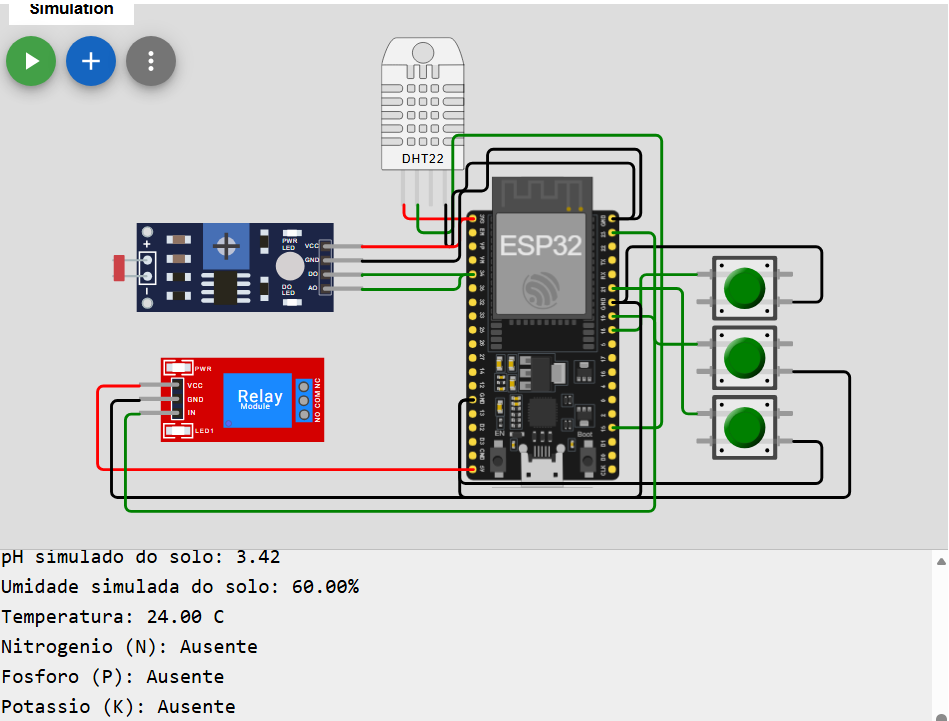

# 🌱 FarmTech Solutions — Fase 2 | IoT com ESP32

## 📌 Sobre o projeto
Projeto acadêmico desenvolvido no curso de Inteligência Artificial da FIAP, com foco na aplicação de Internet das Coisas (IoT) à agricultura inteligente.

O sistema simula o monitoramento de condições agrícolas e o acionamento automático de irrigação utilizando um ESP32 no ambiente Wokwi.

## 🎯 Objetivo
Demonstrar como sensores, microcontroladores e automação podem auxiliar no acompanhamento das condições de cultivo e no uso racional da água.

## 🛠️ Tecnologias utilizadas
- ESP32
- Arduino / C++
- Wokwi (simulação de circuitos)
- Sensor DHT22
- Sensor LDR
- Módulo relé
- Botões para simulação de nutrientes NPK
- Git e GitHub

## ⚙️ Funcionalidades
- Leitura de temperatura e umidade pelo DHT22.
- Leitura de luminosidade por meio do LDR.
- Simulação do pH do solo.
- Simulação da presença de nitrogênio (N), fósforo (P) e potássio (K).
- Controle automático de irrigação por meio de um módulo relé.
- Exibição das informações no monitor serial.

**Observação:** as medições de umidade e temperatura do DHT22 são utilizadas na simulação. O pH e os nutrientes NPK não são medidos por sensores físicos de solo.

## 💧 Lógica de irrigação
O programa utiliza o valor de umidade obtido do DHT22 como referência simulada para o controle da irrigação.

- Umidade inferior a 50%: irrigação ligada.
- Umidade igual ou superior a 50%: irrigação desligada.
- Leitura inválida: irrigação desligada por segurança.

## 🖼️ Circuito desenvolvido

## ▶️ Simulação no Wokwi
[Acessar o projeto FarmTech Fase 2](https://wokwi.com/projects/479071299180016641)

Para executar a simulação, abra o projeto no Wokwi e clique no botão de iniciar.

## 📁 Arquivos do repositório
- `sketch.ino` — código-fonte do ESP32.
- `diagram.json` — configuração dos componentes e conexões.
- `libraries.txt` — dependências do projeto.
- `wokwi-project.txt` — informações exportadas do Wokwi.
- `circuito_farmtech_fase2.png` — imagem do circuito.
- `README.md` — documentação do projeto.

## 🎓 Contexto acadêmico
Projeto FarmTech Solutions — Fase 2, FIAP.

Esta versão foi organizada no GitHub pessoal como parte do desenvolvimento do portfólio acadêmico e profissional, com foco em IoT, automação e aplicações de Inteligência Artificial na agricultura.

## 👨‍💻 Autor
Willians Roberto da Silva

Estudante de Inteligência Artificial — FIAP

[GitHub](https://github.com/williansroberto32-ui)
